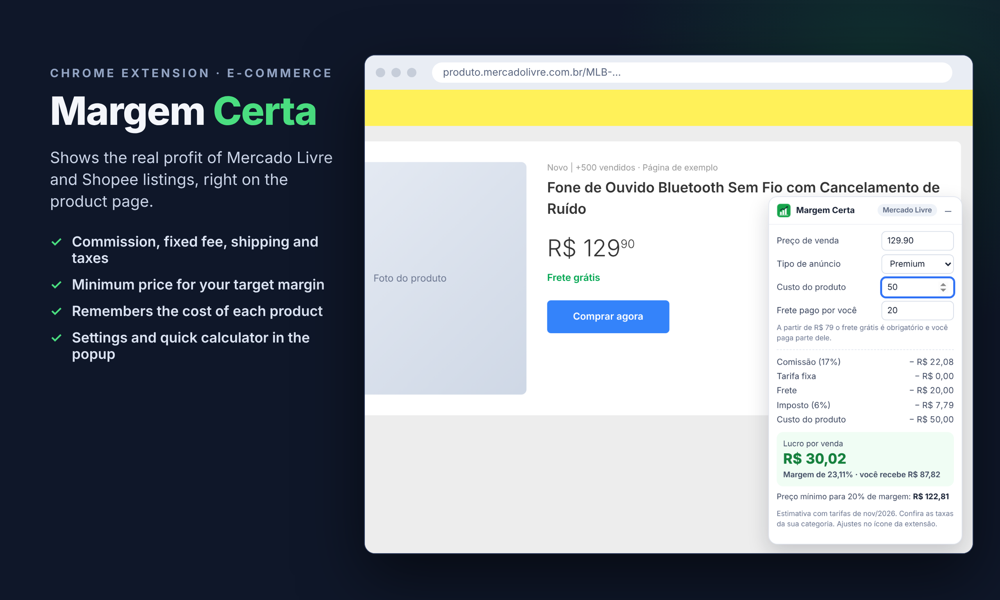

# Margem Certa

[](https://github.com/PabloTosati/margem-certa-extension/actions/workflows/ci.yml)


A Chrome extension for Brazilian online sellers: it shows the **real profit** of a Mercado Livre or Shopee listing, right on the product page, after commission, fixed fee, shipping, taxes and ads.

🇧🇷 [Leia em português](README.pt-BR.md)



## Features

- **Profit card on product pages** of Mercado Livre and Shopee, with the price read automatically
- **Full breakdown**: commission, fixed fee per unit, shipping paid by the seller, tax, ads and product cost
- **Minimum price for a target margin** (for example 20%), solved across every fee range
- **Remembers the cost** and shipping of each listing (saved locally in the browser)
- **Clássico or Premium** listing types on Mercado Livre; CNPJ or high-volume CPF on Shopee
- **Popup with a quick calculator** to simulate a product before listing it
- **Editable fee tables**: fees vary by category and weight, so every Mercado Livre value can be adjusted
- Card can be minimized to a small pill that still shows the profit
- Works on single-page navigation (the marketplaces change pages without reloading)

## Fee rules (November 2026)

| Marketplace | Rule | Default |
| --- | --- | --- |
| Mercado Livre | Commission, Clássico | 12% (10–14% by category) |
| Mercado Livre | Commission, Premium | 17% (15–19% by category) |
| Mercado Livre | Fixed fee under R$ 19 | R$ 6.25, never more than half the price |
| Mercado Livre | Fixed fee R$ 19–48.99 | R$ 7.45 (up to 2 kg) |
| Mercado Livre | Fixed fee R$ 49–78.99 | R$ 8.75 (up to 2 kg) |
| Shopee | Under R$ 8 | 50% |
| Shopee | R$ 8–79.99 | 20% + R$ 4 |
| Shopee | R$ 80–99.99 | 14% + R$ 16 |
| Shopee | R$ 100–199.99 | 14% + R$ 20 |
| Shopee | R$ 200 or more | 14% + R$ 26 |
| Shopee | High-volume CPF (450+ orders in 90 days) | + R$ 3 per item |

The values are estimates based on public information. Marketplaces change their fees often, so always check the current rates for your category.

## Install (developer mode)

1. Download this repository (**Code → Download ZIP**) and unzip it
2. Open `chrome://extensions`, turn on **Developer mode**
3. Click **Load unpacked** and select the project folder
4. Open any product on Mercado Livre or Shopee

## How it works

```
src/fees.js     Fee engine: profit breakdown and price for a target margin
src/detect.js   Finds the listing price (JSON-LD, meta tags, page elements) and ID
src/card.js     Content script: the profit card, in a Shadow DOM so site CSS can't break it
popup/          Quick calculator and settings
demo/           Sample product pages used in the tests
tests/          Unit tests (Node test runner + jsdom)
```

The **price for a target margin** is solved exactly: each fee range is a linear function of the price, so the extension solves the equation per range and keeps the lowest price that falls inside its own range.

## Tests

```bash
npm install
npm test   # 25 tests: fee ranges, price for margin, price parsing, listing IDs
```

The extension was also tested end to end in Chromium on sample product pages: price detection (including a price that loads late), profit for both listing types, saved costs after reload, settings updating the open card, the popup calculator and the minimized mode.

## Privacy

Margem Certa only runs on Mercado Livre and Shopee pages. It does not send data anywhere: product costs and settings are stored in your browser.

Not affiliated with Mercado Livre or Shopee.

## Author

**Pablo Tosati**: I build custom Chrome extensions, automation tools and REST APIs.
[GitHub](https://github.com/PabloTosati) · [Fiverr](https://www.fiverr.com/pablotosati)
