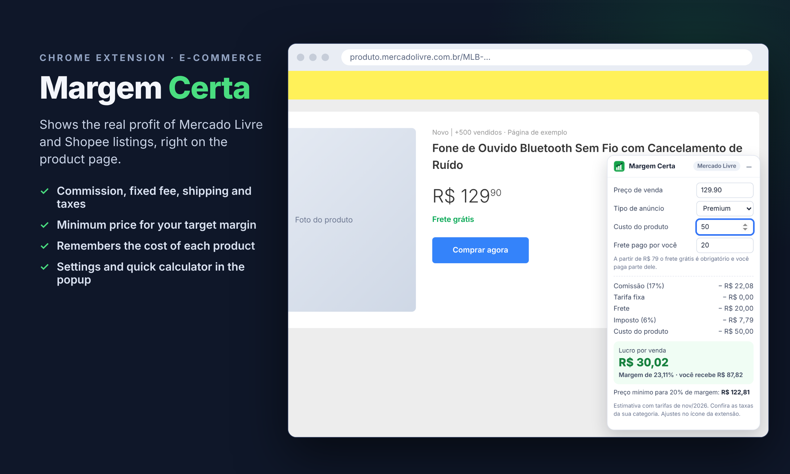

# Margem Certa

Extensão para Chrome que mostra o **lucro real** de um anúncio do Mercado Livre ou da Shopee, direto na página do produto, já descontando comissão, tarifa fixa, frete, imposto e anúncios.

🇺🇸 [Read in English](README.md)

## O que ela faz

- **Cartão de lucro** nas páginas de produto do Mercado Livre e da Shopee, com o preço lido automaticamente
- **Conta completa**: comissão, tarifa fixa por unidade, frete pago por você, imposto, anúncios e custo do produto
- **Preço mínimo para a margem que você quer** (por exemplo, 20%)
- **Lembra o custo** e o frete de cada anúncio (salvos só no seu navegador)
- Anúncio **Clássico ou Premium** no Mercado Livre; **CNPJ ou CPF com muitos pedidos** na Shopee
- **Calculadora rápida** no ícone da extensão, para simular antes de anunciar
- **Tarifas editáveis**: as taxas mudam por categoria e peso, então você ajusta os valores do Mercado Livre
- O cartão pode ser minimizado e continua mostrando o lucro

## Tarifas padrão (novembro de 2026)

| Marketplace | Regra | Padrão |
| --- | --- | --- |
| Mercado Livre | Comissão Clássico | 12% (10–14% conforme a categoria) |
| Mercado Livre | Comissão Premium | 17% (15–19% conforme a categoria) |
| Mercado Livre | Tarifa fixa abaixo de R$ 19 | R$ 6,25, no máximo metade do preço |
| Mercado Livre | Tarifa fixa R$ 19 a 48,99 | R$ 7,45 (até 2 kg) |
| Mercado Livre | Tarifa fixa R$ 49 a 78,99 | R$ 8,75 (até 2 kg) |
| Shopee | Abaixo de R$ 8 | 50% |
| Shopee | R$ 8 a 79,99 | 20% + R$ 4 |
| Shopee | R$ 80 a 99,99 | 14% + R$ 16 |
| Shopee | R$ 100 a 199,99 | 14% + R$ 20 |
| Shopee | A partir de R$ 200 | 14% + R$ 26 |
| Shopee | CPF com mais de 450 pedidos em 90 dias | + R$ 3 por item |

São estimativas baseadas em informações públicas. Os marketplaces mudam as tarifas com frequência: confira sempre as da sua categoria.

## Como instalar (modo desenvolvedor)

1. Baixe este repositório (**Code → Download ZIP**) e descompacte
2. Abra `chrome://extensions` e ative o **Modo do desenvolvedor**
3. Clique em **Carregar sem compactação** e escolha a pasta do projeto
4. Abra qualquer produto no Mercado Livre ou na Shopee

## Privacidade

A Margem Certa só funciona nas páginas do Mercado Livre e da Shopee e não envia dados para lugar nenhum. Custos e configurações ficam salvos no seu navegador. Política completa: [PRIVACY.md](PRIVACY.md).

Não tem relação oficial com o Mercado Livre nem com a Shopee.

## Autor

**Pablo Tosati**: desenvolvo extensões para Chrome, automações e APIs REST.
[GitHub](https://github.com/PabloTosati) · [Fiverr](https://www.fiverr.com/pablotosati)
